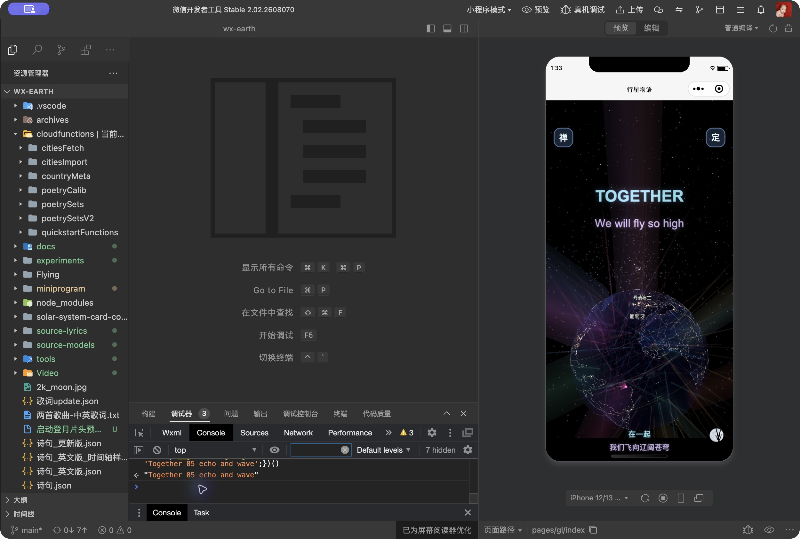
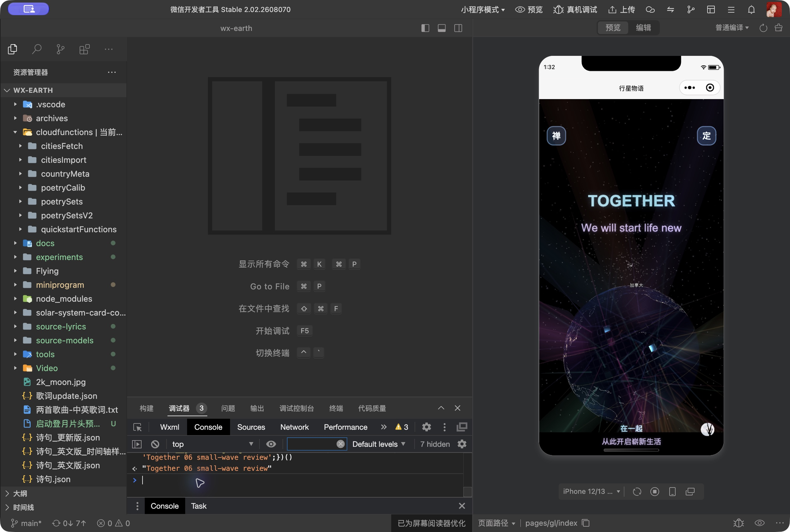
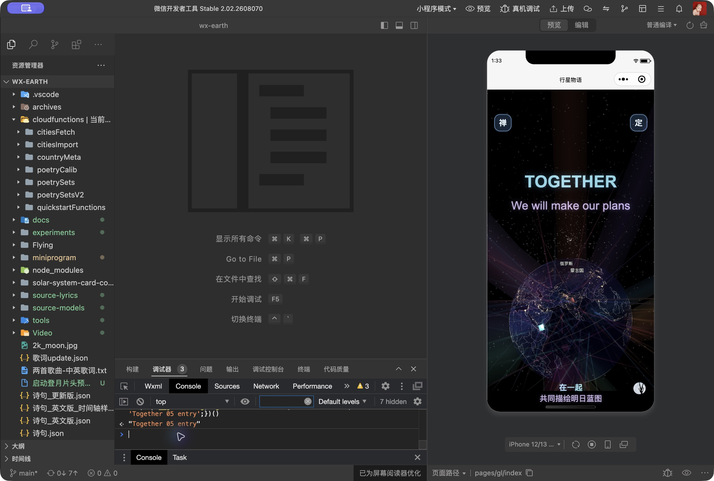

# Together 05—08号组合动效接入

2026-10-23。用户选择Together用A叠影、下句跟唱用第一版C小幅波浪，并要求只替换首次Go West前八组Together的后四组。

## 范围

仅51.44、55.42、59.37、63.39秒起的四组：We will fly so high、Tell all our friends goodbye、We will start life new、This is what we'll do。上下句中英文同步采用对应效果。

叠影沿用已确认独立预览的三层保持/汇合，英文持续1.35秒；跟唱采用第一版C的逐字小幅抬起/回落、轻微转角，英文0.78秒内落稳。按现有字号换算em位移。保留词句、源时刻、字号拟合、位置、单行分页和整组退场。四组不再叠加原来的爆开、帘幕拉开和持续放大。

01—04号、后续主歌/副歌、音乐、地球、片头、霓虹、第八声持续通电、EVE和终场均未修改。新分支仅在上述四个Together时刻启用。运行代码只改go-west-song.js、index.wxml、index.wxss；before目录保留本轮开始前的这三个文件，包含当时已有工作，不是Git基线。

## 检查

- `tools/*.test.cjs`全部49个文件通过，`git diff --check`通过。
- 增补仅四组启用、上下句边界、字影/字母完整性、空格保留、原小波浪错峰、同句跳转重挂载及不逐帧setData检查。
- 744个非目标歌词状态（320/390/430宽度、62条非目标cue的四个时刻）与before代码完全一致，见non-target-verification.json。
- 微信开发者工具wx-earth普通编译0错误，结束时仍为0错误、3条现有警告。
- 确认preset104、真实音频（preview:false），模拟器实看目标段叠影和中英跟唱，核对第04组仍保持原效果。检查后恢复zen:false、preset1、moon:false。

截图记录原生显示，不能单独证明完整动作。未完成全曲自然播放或真机验收；没有上传、发布或导出视频。
