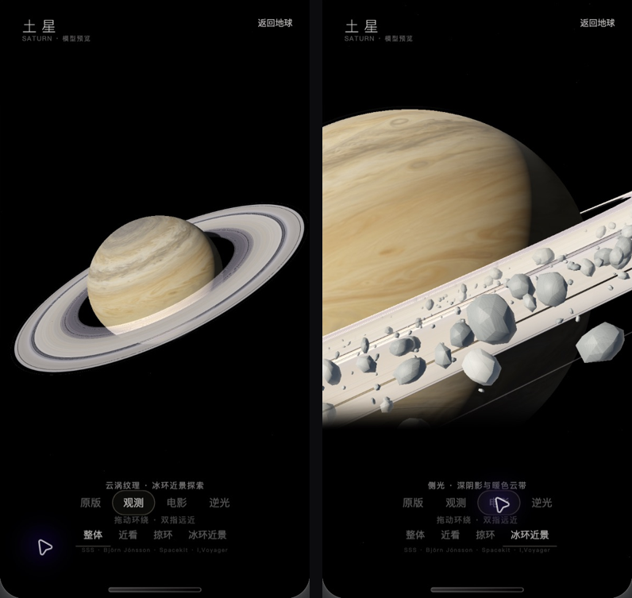

# 土星云涡与冰环近景 v1

入口：主页左下角「土星预览」，底部「冰环近景」。可切换「观测」与「电影」比较照明，点「整体」拉远，右上角返回地球。

## 本次实现

- 使用内置 image_gen 生成无光照、2:1 的艺术云层展开图，运行时包到现有扁球体上。新图包含细云带、涡旋与缓慢纬度漂移；方向光与星环阴影仍由实时 shader 计算。「原版」保留原有贴图。
- 沿用现有 Three.js、Spacekit 星环几何与 I,Voyager 光学剖面方案。新增 1900 个大小不一的冰块，使用 Three.js 二十面体变形，合并为一个网格；近景显示，远景隐藏，缓慢公转和自转。没有新增运行依赖。
- 新视角靠近星环外沿，放大土星背景，切换时平滑移动镜头。近景画面上下柔和淡出，给预览控件留出空间；控件使用画布内 cover-view。
- 这是艺术尺度的局部冰块层，大小、厚度和密度增强用于感受效果，未实现完整体积星环或科学粒子模拟。

贴图原图、实际尺寸、生成方式和完整提示词：[CLOUDS-V1.md](../../../source-models/saturn-preview/CLOUDS-V1.md)。运行图：`miniprogram/saturn-assets/saturn-clouds-v1.jpg`，2048×1024，353596 bytes；生成原图为 1774×887，转换二次幂尺寸不增加原始细节。

## 验证范围

- PASS：全部 34 个 `tools/*.test.cjs`，以及 `git diff --check`。土星检查覆盖四图加载、近景镜头、冰块显示/隐藏、运动、资源释放与重入取消。
- PASS：微信开发者工具 Stable 2.02.2608070、基础库 3.16.1，实际打开当前仓库。新贴图及冰块完成渲染；整体/冰环切换、观测/电影切换、退出恢复地球、再次进入载入成功。界面未出现新的 shader 错误，返回与底部按钮可见可用。
- DEFERRED：真机画质、帧率、双指缩放与实际触摸手感。模拟器原生鼠标拖动未得到明确视角变化证据，触摸逻辑由现有自动检查覆盖，不将其计入真机验收。
- 未重新验收禅定与登月的完整流程；本次实现只在已有土星预览内。

## 运行截图

`*-devtools.png` 为未经处理的工具窗口截图。其余 PNG 仅裁切模拟器的实际画布区域；`comparison.png` 把整体（观测）与近景（电影）并排缩放，不改色彩或添加物体。

