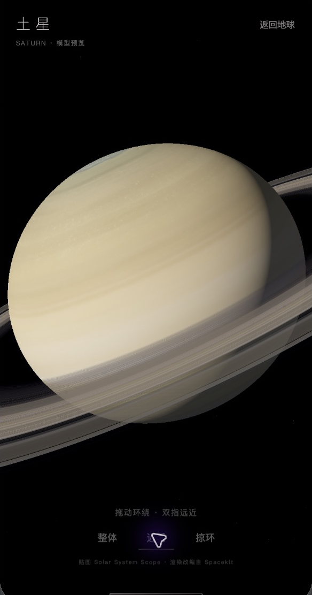
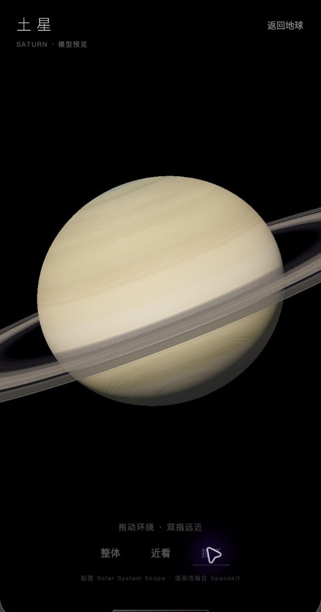
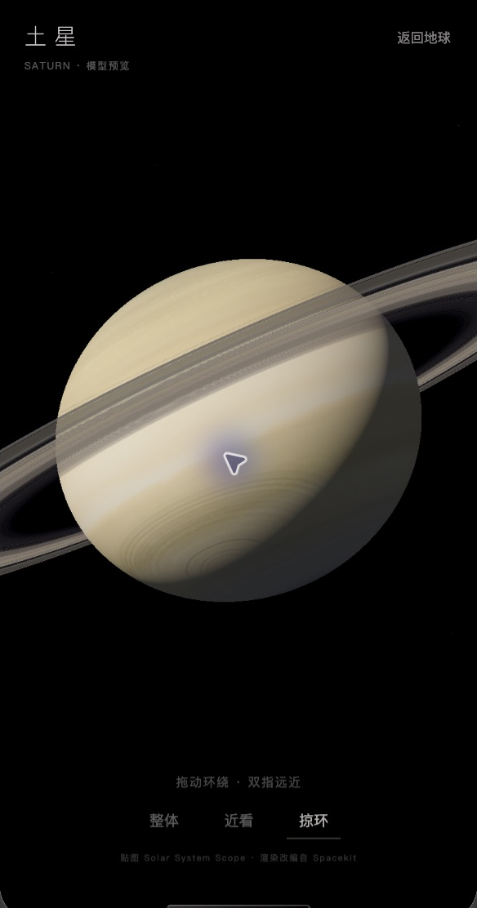
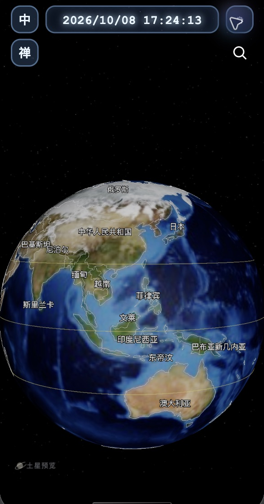

# 土星模型第一版实际预览

2026-10-08。入口：普通主页左下角「土星预览」。这批图片来自微信开发者工具模拟器的真实 WebGL 渲染；不是 AI 概念图。保留完整开发者工具截图，另外裁出模拟器内容供比较。截图中的紫色指针是电脑操作指示，不属于小程序。

## 使用

点击后按需载入土星贴图与星环分包。单指拖动环绕观察，双指改变观察距离；「整体／近看／掠环」切换三个镜头位置，右上角「返回地球」退出。星球云带缓慢转动；镜头停留后不会自动游走。

## 本次核对

- PASS：现有小程序内编译和进入预览，实际读取 4096×2048 JPEG 与 2048×1 RGBA 星环纹理。
- PASS：标题、视角按钮、返回按钮可见；近看和掠环切换，拖动改变观察位置，退出恢复普通地球界面。
- PASS：禅定时隐藏土星入口；加载与输入代码保留 zen/moon 锁，原登月时间线、材质和灯光未改动。
- PASS：32 个 `tools/*.test.cjs` 文件通过，新增测试覆盖旧版 Three 几何兼容、分包异步加载、连续点击、加载中退出/重进、失败后迟到纹理释放、拖动/双指边界、输入交接和 moon lock。`git diff --check` 通过。
- 未核对：真机画质/性能与双指触摸、完整登月动态流程。模拟器鼠标拖动通过；双指逻辑在自动测试中通过。

## 复用与适配

素材与代码出处、许可和处理过程见 [来源记录](../../../source-models/saturn-preview/README.md)。复用 Solar System Scope 的土星/星环贴图，改编 Spacekit 的径向星环采样与投影方法，在现有 scoped Three.js 中运行。没有引入完整浏览器框架或新增 npm 依赖。

独立土星场景与相机共享现有渲染器，不改动地球本体。场景背景保留透明合成，以免微信原生画布遮挡 WXML 浮层；页面黑底提供宇宙背景。加载失败支持重试，关闭或页面卸载后释放纹理、材质和几何。

这是模型评审界面，尚未实现真实公转、卫星、从地球出发的飞行或完整太阳系玩法。贴图能提供当前近景的云带细节，不能据此承诺无限靠近仍有微观细节。
