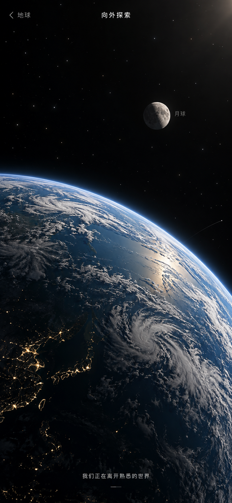
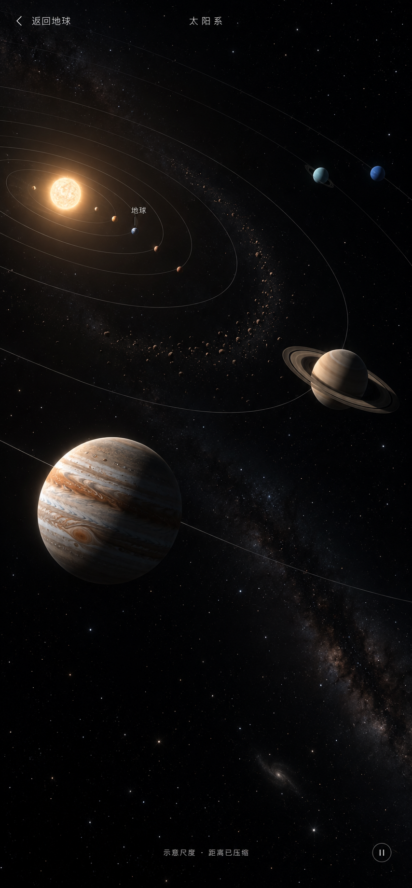
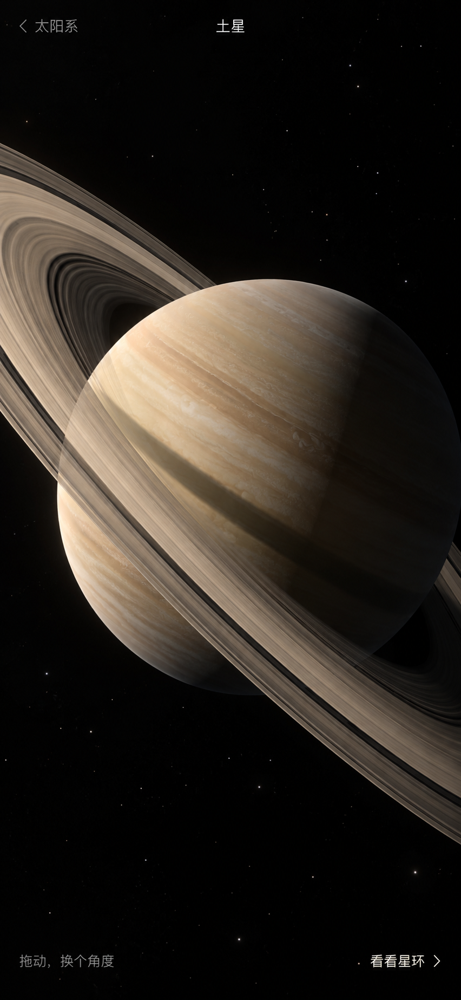
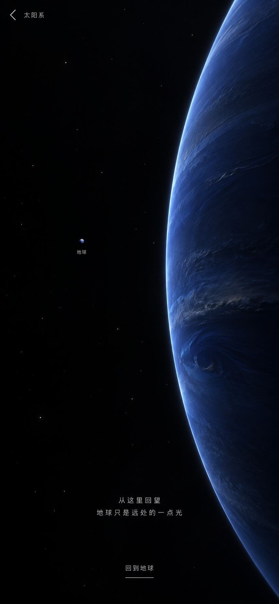

# 太阳系手机竖屏概念图

2026-10-08，使用内置 imagegen 生成，约 9:19.5 手机竖屏比例。用于感受构图、光照、尺度与情绪，并为后续 3D 场景提供参照。图片采用示意尺度，太阳系总览的天体配置、轨道与科学比例需在实现时校准。本轮未接入小程序、未改现有地球／禅定／登月代码。

## 1. 离开地球：熟悉的世界开始退远

进入太阳系的过渡关键帧。近处的地球大弧面与远处月球建立深度，地球的云、夜灯和蓝色大气边缘仍然可以认出。3D 参照重点：连续相机退远、近远景对比、大气边缘与昼夜层次。

## 2. 太阳系展开：第一次看见更大的关系

进入后的探索总览。太阳与内行星在远处，木星成为近景，土星与外行星向另一侧延伸，斜向轨道贯穿竖屏。3D 参照重点：用透视和景别组织信息，细轨道、太阳光与球体明暗统一；不要求所有天体始终完整同屏。

## 3. 靠近土星：庞然大物悬在面前

选中行星后的近景。星环跨出屏幕，球体、环和阴影构成重量感。3D 参照重点：环的前后遮挡、环带纹理、球体与环之间的投影，拖动视角时仍保持实体空间关系。

## 4. 在远处回望地球：空旷与压迫同时出现

外太阳系的停驻构图。巨大的蓝色行星占据右侧，大片黑暗里只有小小的地球。3D 参照重点：巨大近景与微小远景对照，暗部留白、稀疏星点与克制文字，支持回到地球。

完整提示词见 [PROMPTS.md](PROMPTS.md)。
